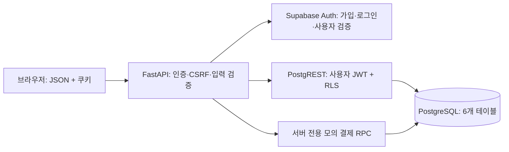

# 백엔드 구조와 인증 흐름

[프로젝트 실행 안내](../README.md) · [API 명세](api-spec.md)

## 주요 코드

| 파일 | 역할 |
|---|---|
| [main.py](../app/main.py) | FastAPI 초기화, HTTPX 연결 풀, 라우터, CSRF·오류·보안 헤더 |
| [config.py](../app/config.py) | 환경변수 검증과 설정 |
| [supabase_client.py](../app/supabase_client.py) | Supabase Auth·PostgREST·RPC HTTP 요청과 오류 변환 |
| [auth.py](../app/auth.py) | 쿠키, 현재 회원 검증, 안전한 next, 인증 요청 제한 |
| [schemas.py](../app/schemas.py) | Pydantic JSON 입력 검증 |
| [인증 라우터](../app/routers/auth.py) | 가입·로그인·로그아웃·갱신·CSRF |
| [회원 라우터](../app/routers/users.py) | 프로필·탈퇴 |
| [상품 라우터](../app/routers/products.py) | 공개 상품 조회 |
| [장바구니 라우터](../app/routers/cart.py) | 본인 장바구니 관리 |
| [주문 서비스](../app/services/orders.py) | 주문 생성·소유권·상세 조회 조합 |
| [주문 라우터](../app/routers/orders.py) | 주문 생성·목록·상세·취소 |
| [결제 라우터](../app/routers/payments.py) | 소유권 확인 후 서버 전용 모의 결제 RPC |

## 요청 경로

각 사용자 JWT는 요청별 HTTP 헤더로만 전달합니다. 공유 HTTPX 클라이언트에는 사용자 Authorization 헤더를 저장하지 않습니다. 서버 관리자 키는 모의 결제와 인증 계정 삭제에 사용합니다. API 키는 환경변수에서만 읽습니다.

공개·비밀 API 키는 apikey 헤더로 전달하고, 사용자 JWT는 Authorization 헤더로 전달합니다. 기존 JWT 형태의 anon/service_role 키도 처리합니다. [Supabase 공식 API 키 안내](https://supabase.com/docs/guides/getting-started/api-keys)

## 인증과 CSRF

1. GET `/api/v1/auth/csrf`가 임의 토큰을 응답과 shop_csrf 쿠키에 저장합니다.
2. 로그인 요청은 쿠키와 같은 X-CSRF-Token 및 JSON을 전달합니다. Origin이 있으면 APP_ORIGIN과도 비교합니다.
3. Supabase의 이메일·비밀번호 로그인 결과를 검증하고 access·refresh 토큰을 HttpOnly 쿠키에 저장합니다. JSON으로 토큰을 반환하지 않습니다.
4. 보호 API는 access 토큰을 Supabase `/auth/v1/user`에 전달해 검증하고, 실제 public.users 프로필도 확인합니다.
5. 프로필·장바구니·주문 요청은 해당 사용자 JWT로 실행되어 RLS도 적용됩니다.

| 쿠키 | 범위 | JavaScript 읽기 | 수명 |
|---|---|---|---|
| shop_access | `/` | 불가 | Supabase expires_in |
| shop_refresh | `/api/v1/auth` | 불가 | 최대 7일의 브라우저 보관 기간 |
| shop_csrf | `/` | 가능 | 최대 7일 |

모든 쿠키는 SameSite=Lax이며 HTTPS 배포에서는 Secure입니다. Refresh 쿠키 보관 기간은 Supabase의 실제 세션 유효기간을 늘리지 않습니다.

인증 오류 응답은 JSON 401입니다. 클라이언트는 한 번만 갱신을 시도하고, 실패하면 현재 화면을 next에 보존하여 로그인으로 이동하도록 Step 3에서 구현합니다. 갱신 요청을 병렬로 반복하지 않도록 해야 합니다.

로그아웃은 Supabase의 local 범위 세션 갱신 권한을 해제하고 쿠키를 삭제합니다. 만료된 access 토큰만 있으면 refresh로 세션을 얻어 해제합니다. 이미 발급된 access JWT는 원래 만료 시각까지 유효할 수 있습니다. [Supabase 로그아웃 설명](https://supabase.com/docs/guides/auth/signout)

인증 요청은 프로세스 내 IP·사용자 식별 조합 기준 1분당 10회로 제한하고 Supabase의 별도 제한도 적용받습니다. 식별값은 메모리에 해시로 보관합니다. 다중 서버 환경에서 공유되는 제한은 아니므로 규모 확장 시 게이트웨이 등에서 통합 제한을 적용해야 합니다.

## 주문과 결제

- 장바구니 구매·바로 구매 모두 선택 상품 ID·수량을 고정한 items 배열로 주문을 요청합니다. 서버는 클라이언트 단가를 받지 않습니다.
- p_expected_total은 금액 확인값이며 실제 가격 계산은 DB가 수행합니다.
- 주문 요청의 order_id를 네트워크 재시도에 재사용합니다. 장바구니가 이후 변경되어도 원래 items를 재사용합니다.
- create_order는 주문·주문 항목을 함께 생성하며 재고를 예약하지 않습니다.
- pay_mock_order는 주문과 상품 잠금을 사용해 재고 차감·결제 성공·주문 완료를 함께 확정합니다. 이미 성공한 주문은 재처리하지 않습니다.
- 장바구니 추가는 add_cart_item의 원자적 UPSERT로 수량을 더합니다. 장바구니 수량 수정은 지정한 절대 수량으로 변경합니다.
- 결제 후에도 장바구니 항목은 유지합니다. 구매 내역은 `status=paid`로 조회합니다.

SQL의 트랜잭션 처리는 DB에 실제 설치되어야 작동합니다. HTTP 요청 여러 개를 나열하여 트랜잭션을 흉내 내지 않습니다.

## 탈퇴와 오류

탈퇴는 현재 로그인 확인에 더해 비밀번호 재확인을 요구합니다. 재확인용 임시 세션을 종료한 뒤 서버 관리자 권한으로 Supabase Auth 계정을 삭제합니다. 회원 프로필·장바구니는 FK에 따라 삭제되고 주문 회원 연결은 해제됩니다. 주문·결제 및 주문 배송정보의 별도 보존 정책은 SQL 문서를 따릅니다.

입력 오류·업스트림 오류는 JSON으로 통일하고 비밀번호·토큰·SQL 내부 오류를 응답에 포함하지 않습니다. 모든 API 응답은 Cache-Control: no-store입니다.

## Step 3 연결

HTML 라우팅·모바일 UI·브라우저 측 로그인 이동·결제 후 상품 목록 이동까지 연결했습니다. 루트는 쇼핑몰 화면이며 보호 HTML 경로는 서버의 303 로그인 리다이렉트를 사용합니다. API는 기존대로 JSON 401을 반환합니다. [화면 구조](frontend.md)와 [실행 안내](run-guide.md)를 참고하세요.

로컬 체험은 SHOP_DEMO=true일 때만 별도의 메모리 전송 계층을 사용합니다. 실제 연결 모드의 Supabase 요청과 SQL 처리는 유지합니다. GET `/api/v1/config`는 demo_mode·mock_payments_enabled 공개 플래그만 제공합니다.
