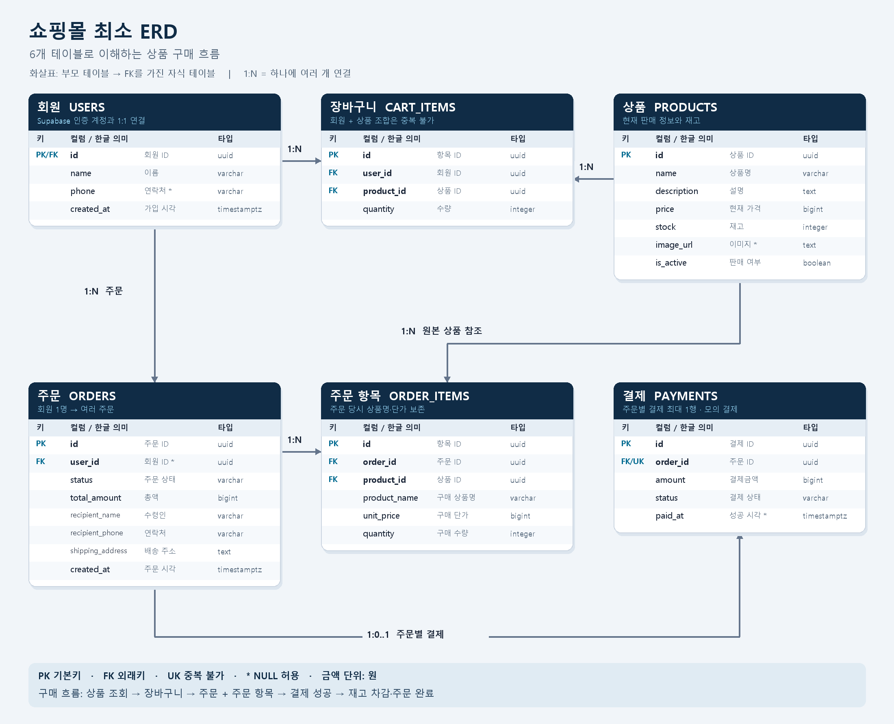
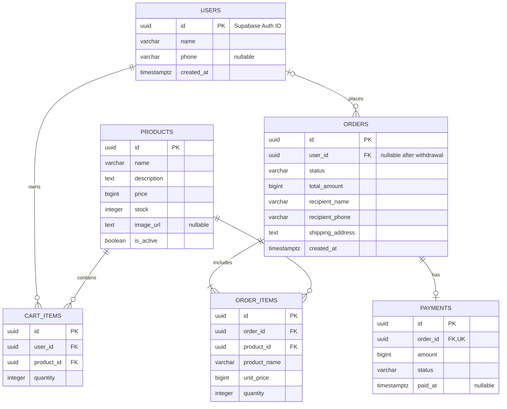

# 최소 ERD

[문서 목록](README.md) · [테이블 정의](table-definition.md) · [구매 시뮬레이션](purchase-simulation.md) · [Mermaid 원본](erd.mmd)

## 테이블 이미지

[PNG 이미지 열기](erd-tables.png) · [확대용 SVG 열기](erd-tables.svg)

각 표에 컬럼명·한글 의미·타입을 표시했습니다. 화살표는 부모 테이블에서 외래키를 가진 자식 테이블로 향합니다. `1:N`은 하나에 여러 개, `1:0..1`은 하나에 최대 한 개가 연결된다는 의미입니다. 회원 탈퇴 후에는 주문의 회원 연결이 해제될 수 있습니다.

## Mermaid 관계도

아래 블록은 `erd.mmd`와 동일합니다. Mermaid를 지원하는 Markdown 미리보기에서 관계도로 렌더링됩니다.

## 관계 읽기

| 관계 | 의미 |
|---|---|
| 회원 → 장바구니 항목, 1:N | 회원 한 명이 여러 상품을 담습니다. |
| 상품 → 장바구니 항목, 1:N | 같은 상품을 여러 회원이 담을 수 있습니다. |
| 회원 → 주문, 1:N | 회원 한 명이 여러 번 주문합니다. 탈퇴 후에는 주문의 회원 연결만 해제됩니다. |
| 주문 → 주문 항목, 1:N | 한 주문은 하나 이상의 상품을 포함합니다. |
| 상품 → 주문 항목, 1:N | 같은 상품이 여러 주문에 포함될 수 있습니다. |
| 주문 → 결제, 1:0..1 | 결제 전에는 없고, 첫 결제 시도부터 한 레코드를 유지합니다. |

`auth.users`는 Supabase가 관리하는 인증 테이블이므로 위 업무 ERD에서는 생략했습니다. 실제 `public.users.id`는 `auth.users.id`를 참조하는 PK 겸 FK입니다.

장바구니에는 현재 상품을 참조하고, 주문 항목에는 주문 당시 상품명과 가격을 복사합니다. 따라서 상품 가격을 수정해도 과거 구매 내역은 바뀌지 않습니다.
