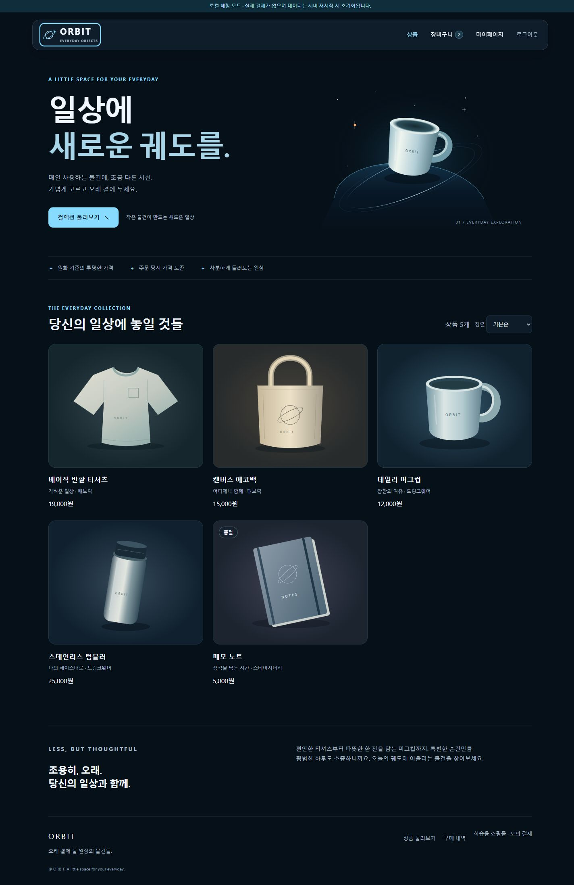

# Step 3 — 화면과 프론트엔드 구조

[실행 방법](run-guide.md) · [API 명세](api-spec.md)

AGENTS.md의 사용성 우선, 모바일 우선 반응형, 우주·Liquid Design 지침을 반영했습니다. 정적인 천체·궤도 일러스트, 어두운 여백, 하늘색 주요 행동 버튼을 사용합니다. 유리 효과는 상단 내비게이션에 제한하고 폼·장바구니·결제정보에는 안정적인 불투명 표면을 사용합니다.

## 소스 파일

| 파일 | 역할 |
|---|---|
| [index.html](../frontend/index.html) | 한국어 문서·공통 내비게이션·본문·푸터·접근성 안내 |
| [style.css](../frontend/assets/css/style.css) | 모바일·데스크톱 레이아웃, 포커스·버튼 상태, 효과·동작 감소 |
| [app.js](../frontend/assets/js/app.js) | 경로별 화면, 장바구니·주문·회원정보 상호작용 |
| [api.js](../frontend/assets/js/api.js) | JSON fetch·CSRF·한 번의 세션 갱신·오류 처리 |
| [ui.js](../frontend/assets/js/ui.js) | 안전한 텍스트 출력·금액·수량·알림·로그인 복귀 경로 |
| [images](../frontend/assets/images/) | 외부 다운로드 없이 작성한 상품·행성·브랜드 SVG |
| [web.py](../app/web.py) | HTML 경로 제공·보호 화면 303 리다이렉트·정적 파일 |
| [demo.py](../app/demo.py) | 로컬 전용 메모리 체험. 실제 모드에서는 사용하지 않음 |

HTML 셸 하나를 경로별로 렌더링하며 화면 이동은 일반 링크와 브라우저의 정상 탐색을 사용합니다. JavaScript 모듈은 브라우저에서 직접 실행합니다. React·Vue·Node.js 플랫폼·npm·외부 프론트엔드 라이브러리와 빌드 단계가 없습니다.

## 화면

| 경로 | 주요 기능 |
|---|---|
| / | 우주 테마 소개·상품 목록·가격 정렬·더 보기·품절 표시 |
| /products/{id} | 상세 설명·수량·합계·담기·바로 구매 |
| /login, /signup | 폼 검증·이메일 인증 안내·next 보존 |
| /cart | 선택 구매·수량 변경·삭제·전체 비우기·금액 |
| /checkout | 배송정보·확인 동의·주문 생성·모의 결제 |
| /mypage | 회원정보·수정·구매 내역 진입 |
| /mypage/edit | 이름·연락처 수정·회원 탈퇴 |
| /mypage/orders | 완료·대기·취소 주문별 목록 |
| /mypage/orders/{id} | 주문 당시 상품·가격·배송·결제·미결제 취소 |

## 인증과 안전한 복귀

- 보호 HTML 경로는 서버가 인증을 검사하고 게스트를 `/login?next=...`로 303 이동시킵니다.
- 로그인 응답의 next는 서버에서 검증하며 클라이언트도 허용된 동일 출처 경로만 사용합니다.
- 상품에서 비로그인 담기를 누르면 상품 ID·수량·담기 의도를 sessionStorage에 잠시 보관합니다. 로그인 후 같은 상품·수량 경로에 돌아왔을 때 의도를 제거하고 한 번만 담습니다.
- 바로 구매는 product_id·quantity를 checkout 쿼리에 보존하고 로그인 후 주문 화면으로 복귀합니다. 로그인 직후 결제를 실행하지 않습니다.
- 갱신 요청은 한 탭에서 하나의 Promise로 공유하고 최대 한 번 재시도합니다. 갱신할 수 없으면 next를 보존해 로그인으로 이동합니다.
- 토큰·비밀번호는 JavaScript 저장소에 보관하지 않습니다. 구매 중인 상품·주문 재시도 본문은 탭의 sessionStorage에만 보관하고 사용자 ID를 확인합니다. 재시도 본문에는 배송정보가 포함되며, 완료·로그아웃·탈퇴 시 제거합니다.

## 주문 재시도와 오류

주문 UUID와 본문은 제출 전에 저장합니다. 응답 유실·일시적 장애에는 같은 본문·ID로 재시도합니다. 이미 생성되었을 수 있는 주문의 배송정보는 잠가 잘못된 재주문을 방지합니다. 수정하려면 미결제 주문을 취소하고 새로 주문합니다.

결제 성공은 HTTP 상태만 보지 않고 payment.status=succeeded 및 order.status=paid를 함께 확인합니다. 가격이 변경되면 최신 금액을 다시 불러와 확인하게 하고, 재고 부족·로그인 만료·연결 오류를 화면에 안내합니다.

상품·회원 데이터는 HTML 출력 전에 이스케이프합니다. HTML 응답에는 자체 스크립트·스타일만 허용하는 CSP를 적용합니다. 상품 이미지 URL은 동일 출처 또는 HTTPS만 사용하며, 기본 상품 이미지는 설명용 일러스트임을 표시합니다.

## 반응형·접근성 확인

- 실제 브라우저에서 320px·390px·1440px 폭을 확인했고 주요 화면에서 가로 넘침과 깨진 이미지가 없었습니다.
- 모바일 장바구니 수량 변경 후 합계와 구매 버튼 상태를 갱신하며, 저장 중에는 다음 단계 이동을 막습니다. 갱신 후 키보드 포커스를 복원합니다.
- label·required·입력 타입, 건너뛰기 링크, aria-live 알림, 오류 영역, 품절·선택·로딩·비활성 상태를 제공합니다.
- 기본 텍스트 대비는 17.78:1, 패널의 보조 텍스트는 8.53:1, 주요 버튼 텍스트는 10.84:1로 계산했습니다. 포커스 표시를 확인했고 한국어 본문에는 과도한 자간을 적용하지 않았습니다.
- CSS에는 prefers-reduced-motion에서 변형·전환을 제거하는 규칙과 backdrop-filter 미지원 시 불투명 내비게이션을 제공합니다. 별도 시스템 설정을 변경한 실브라우저 검증 및 200% 텍스트 확대의 추가 수동 점검은 배포 전 권장합니다.

## 검증 이미지

모바일 화면 이미지는 [mobile-home.jpg](screenshots/mobile-home.jpg)를 참고하세요.
