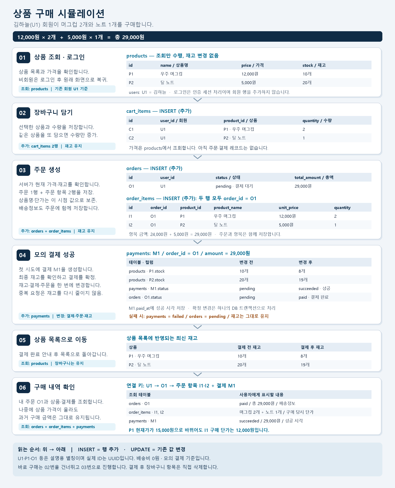

# 상품 구매 시뮬레이션 — 테이블 관점

[문서 목록](README.md) · [ERD](erd.md) · [테이블 정의](table-definition.md)

## 이미지로 보는 구매 흐름

[PNG 원본 열기](purchase-simulation.png) · [확대용 SVG 열기](purchase-simulation.svg)

위에서 아래로 읽으면 됩니다. 왼쪽은 사용자 행동, 오른쪽은 해당 단계의 테이블 데이터입니다. 결제 단계에는 변경 전·후 값을 비교했습니다. 실제 서비스 실행 결과가 아닌 기존 ERD를 기준으로 구성한 예제입니다.

## 예제 데이터

아래 ID는 읽기 쉬운 별칭입니다. 실제 저장값은 UUID입니다. 배송비는 0원입니다.

| users.id | name |
|---|---|
| U1 | 김하늘 |

| products.id | name | price | stock | is_active |
|---|---|---:|---:|---|
| P1 | 우주 머그컵 | 12000 | 10 | true |
| P2 | 달 노트 | 5000 | 20 | true |

김하늘 회원이 머그컵 2개와 노트 1개를 구매합니다. 총액은 **12,000 × 2 + 5,000 × 1 = 29,000원**입니다.

## 1. 상품 조회와 로그인

| 사용자 행동 | 테이블 처리 | 결과 |
|---|---|---|
| 상품 목록·상세 보기 | products SELECT | 상품과 현재 가격·재고 표시 |
| 비로그인 상태에서 구매 클릭 | 업무 테이블 변경 없음 | 로그인 화면으로 이동, next 경로 보존 |
| 회원가입 | Supabase 인증 계정 생성 + users INSERT | U1 프로필 생성 |
| 로그인 | Supabase 인증 세션 생성 | next 경로로 복귀, users 행 추가 없음 |

예: `/checkout?product_id=P1&quantity=2`를 next에 보존하면 로그인 후 같은 상품과 수량의 결제 화면으로 돌아옵니다. next는 허용된 내부 경로만 사용합니다. 로그인 복귀만으로 결제를 실행하지 않습니다.

## 2. 장바구니 담기

`cart_items`에 두 행을 추가합니다. 같은 상품을 또 담으면 INSERT 대신 수량을 UPDATE합니다.

| id | user_id | product_id | quantity |
|---|---|---|---:|
| C1 | U1 | P1 | 2 |
| C2 | U1 | P2 | 1 |

이 시점에는 `orders`, `order_items`, `payments`에 아무것도 생성하지 않으며 재고도 줄지 않습니다.

## 3. 주문하기

서버가 판매 상태·가격·재고를 다시 확인하고, 한 트랜잭션에서 주문과 항목을 생성합니다. 금액이 장바구니 표시 때와 달라졌다면 변경된 금액을 사용자에게 안내하고 결제를 확인받습니다.

**orders — INSERT**

| id | user_id | status | total_amount | recipient_name | recipient_phone | shipping_address |
|---|---|---|---:|---|---|---|
| O1 | U1 | pending | 29000 | 김하늘 | 010-0000-0000 | 01234 서울시 예제구 예제로 1, 101호 |

**order_items — INSERT 2건**

| id | order_id | product_id | product_name | unit_price | quantity |
|---|---|---|---|---:|---:|
| I1 | O1 | P1 | 우주 머그컵 | 12000 | 2 |
| I2 | O1 | P2 | 달 노트 | 5000 | 1 |

장바구니 구매에서는 선택한 항목을 읽어 복사합니다. 바로 구매에서는 상품과 수량을 직접 받아 같은 주문 테이블을 만듭니다. **주문 생성만으로 장바구니를 비우거나 재고를 차감하지 않습니다.**

## 4. 모의 결제하기

첫 결제 요청에서 `payments`를 생성합니다.

| id | order_id | amount | status | paid_at |
|---|---|---:|---|---|
| M1 | O1 | 29000 | pending | NULL |

모의 결제 성공을 확정할 때 아래 변경을 한 DB 트랜잭션으로 처리합니다.

| 테이블 | 변경 전 | 변경 후 |
|---|---|---|
| products, P1.stock | 10 | 8 |
| products, P2.stock | 20 | 19 |
| payments, M1.status | pending | succeeded |
| payments, M1.paid_at | NULL | 결제 성공 시각 |
| orders, O1.status | pending | paid |

확정 시점에 재고가 부족하면 차감·완료 처리를 하지 않습니다. 모의 결제 실패는 `payments.status=failed`로 기록하고 `orders.status=pending`을 유지합니다.

실제 PG 호출은 이 트랜잭션에 포함하지 않습니다. 실제 결제로 확장할 때는 PG 결과 검증과 보상·재처리 설계가 별도로 필요합니다.

## 5. 장바구니 정리와 화면 이동

최소 구현에서는 결제 후에도 장바구니 항목을 유지합니다. 사용자는 장바구니에서 직접 삭제할 수 있습니다. 이 규칙은 장바구니 구매·바로 구매 모두 동일하여, 결제 도중 다른 탭에서 수정한 장바구니를 잘못 삭제하지 않습니다.

결제 성공 안내와 함께 상품 목록 `/`으로 이동합니다. 목록에서 P1 재고는 8개, P2 재고는 19개로 조회됩니다.

## 6. 구매 내역 확인

| 확인할 정보 | 읽는 테이블 |
|---|---|
| 내 주문 목록·주문일·상태·총액 | orders, 조건 user_id = U1 |
| 주문한 상품명·수량·단가 | order_items, 조건 order_id = O1 |
| 결제 상태·금액·성공 시각 | payments, 조건 order_id = O1 |

이후 `products.P1.price`가 15,000원으로 바뀌어도 `order_items.I1.unit_price`는 12,000원입니다. O1의 총액도 29,000원을 유지합니다.

## 예외 상황

| 상황 | 테이블 처리와 화면 결과 |
|---|---|
| 모의 결제 실패 | payments=failed, orders=pending, 재고 유지. 같은 결제 행으로 재시도 가능 |
| 결제 버튼 중복 클릭 | O1을 잠그고 기존 성공 여부 확인. 성공한 주문이면 기존 결과 반환, 재고 중복 차감 없음 |
| 다른 회원이 먼저 구매하여 품절 | 결제 확정 시 재고 검증 실패. 주문 완료·재고 차감 없음, 결제 실패 안내 |
| 미결제 주문 취소 | orders=cancelled. 재고를 예약하지 않았으므로 복원할 재고 없음 |
| 로그인 세션 만료 | 401 응답 → 현재 경로를 next로 보존 → 로그인 후 복귀 |
| 회원정보 수정 | users UPDATE. 기존 주문 배송정보와 주문 항목은 유지 |
| 로그아웃 | 인증 세션 종료. 장바구니·주문 데이터 유지 |
| 회원 탈퇴 | 인증 계정·users·cart_items 삭제. orders.user_id=NULL, 거래 기록 유지 |

결제가 성공한 주문은 필수 구매 내역이며, 취소·실패한 주문은 상태를 구분하여 표시합니다. 미결제 주문은 재고를 점유하지 않으므로 이 최소 설계에는 만료 정리 작업을 두지 않습니다.
